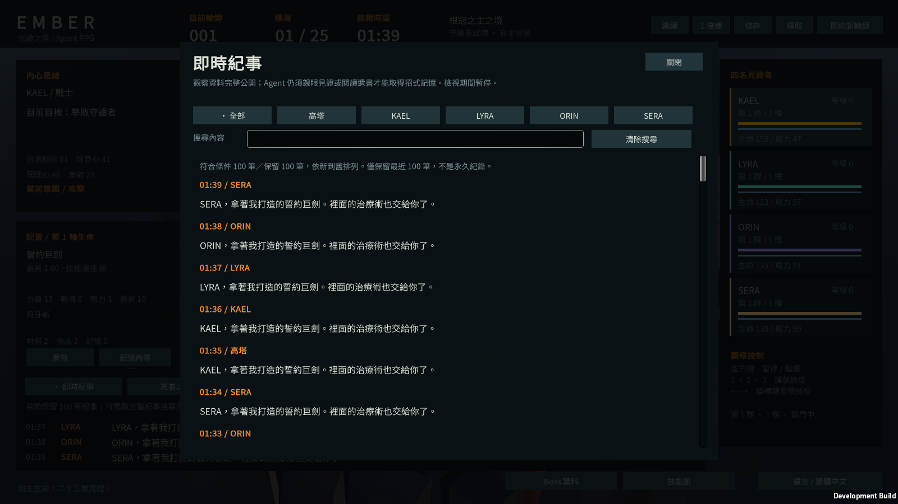
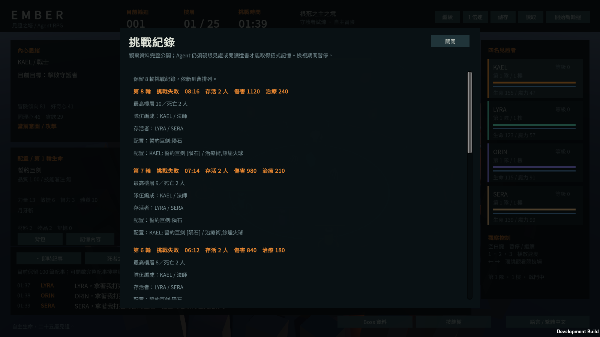

# 觀察紀事與挑戰紀錄

日期：2026-10-11。

## 本次改善

- 即時紀事新增「查看完整紀事」，閱讀目前保留的最近 100 筆訊息；不是永久日誌。
- 開啟時預設篩選目前角色，可切換全部、高塔或四名角色。搜尋對象是目前語言顯示的訊息內容，忽略英文字母大小寫與查詢前後空白。
- 依新到舊排列，捲動閱讀長內容；找不到結果時提示切換角色或清除搜尋。
- 挑戰紀錄新增完整閱讀介面，展示保留的各輪結果、最高樓層、死亡人數、編成、存活者、輸出、治療與配置。舊存檔的裝備／技能 ID 於顯示時轉成目前語言，不改寫原始存檔。
- 開啟閱讀介面時暫停模擬，關閉或按 Escape 後恢復原本暫停狀態。閱讀介面開啟期間停用數字播放速度快捷鍵，避免搜尋輸入干擾速度。
- 新增字串均放入 zh-TW／en 字串表；歷史配置顯示快取有上限，切換語言會失效。

## 驗證方式

短程入口 `--journal-qa` 包含 9 個受控介面案例：全部、角色、高塔、搜尋、查無結果、紀事底部、歷史紀錄、歷史底部與空歷史。

案例檢查角色／高塔篩選、排序、中文／英文顯示內容搜尋、空查詢、暫停恢復、觀察不改變模擬狀態，以及舊配置識別字顯示。畫面檢查沿用專案的文字高度、字型缺字與字串鍵診斷。

最終 Windows Development 建置通過，退出碼 0，耗時 84.24 秒。中文化檢查通過 651 個字串鍵與 899 個字元。

| 案例 | 語言／解析度 | 截圖數 | 結果 |
| --- | --- | ---: | --- |
| 紀事與歷史 | zh-TW／1600×900 | 9 | 退出碼 0、版面問題 0 |
| 紀事與歷史 | en／1280×720 | 9 | 退出碼 0、版面問題 0 |
| 死者之書、Boss、技能樹回歸 | zh-TW／1600×900 | 13 | 退出碼 0、版面問題 0 |
| 背包、記憶、鏡頭與提示回歸 | zh-TW／1280×720 | 14 | 退出碼 0、版面問題 0 |

共 45 張最終成品截圖。四個短程 Player 日誌未記錄 Exception 或 JobTempAlloc；人工抽查中文紀事、搜尋、捲動底部、歷史配置及英文紀事／歷史，未見缺字、方框字或內容溢出。這不是全部自然遊玩狀態的人工檢查，也不是長時間效能認證。

前兩次建置在 240／480 秒上限停止，日誌完整保留；中間成品雖然版面檢查通過，人工發現歷史配置被通用翻譯回退遮蔽，故修正解析順序、增加實際裝備與技能名稱斷言並重新建置。上表只使用最終修正版，不混入中間結果。

[結構化證據與成品雜湊](../Evidence/observer-journal-validation.json)。本機成品：`Builds/ObserverJournal/Development/Ember.exe`。重現建置入口：`Ember.Editor.ProjectBuilder.BuildJournal`；此入口只執行中文化檢查與開發版建置，未呼叫大型模擬。

## 代表畫面

以下是未修改的 Windows Player 受控 QA 截圖。100 筆重複訊息與 8 輪歷史資料為測試注入，用於檢查搜尋、長列表與版面，不是自然遊玩或 Agent 決策品質證據。

本次未執行完整平衡 Gate、5000 個種子模擬或 120 分鐘穩定性測試；歷史 Gate 未通過的結果仍保留。

## 邊界

本次改善觀察介面，未修改戰鬥、隊伍效用、記憶、資料欄位與存檔格式。部分舊挑戰配置只保存武器與灌注；介面不補造當時未儲存的技能、品質或升級數值。紀事仍只保留現有系統的最近 100 筆訊息，跨輪永久事件匯出尚未實作。既有公開 Windows Release 仍是原展示版，本次本機開發成品不會自動取代它。
