# Portfolio RC 0.3.1 實機圖集

2026-10-11，新建 Windows Release，1920×1080 與 1600×900。全部為修補後 Player 的原始擷取，無 Development overlay；部分畫面刻意注入事件／历史紀錄以測試邊界，不代表自然遊玩或通關。

## Hero 候選圖

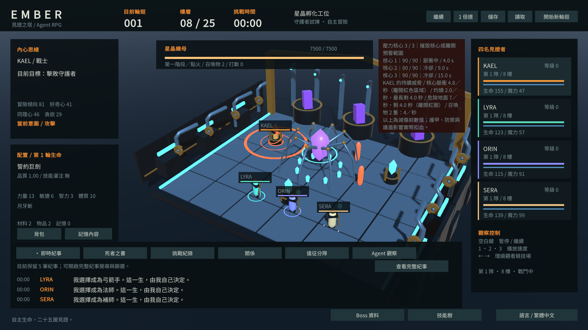

四名角色與 Boss 全部可見，中心演出未受底部 UI 遮擋。作為 README／網站／推甄素材；GitHub 社群預覽設定尚未更新，且本輪公開 Release Gate 未通過。

## 主觀察介面：四名 Agent 與根冠之主

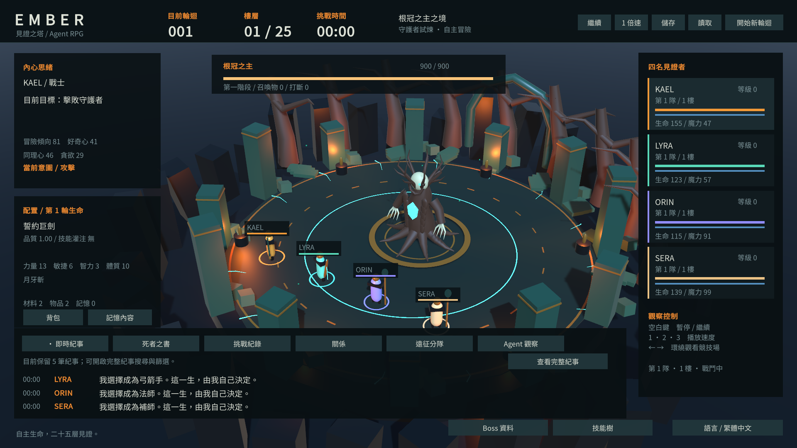

## Boss 階段轉換

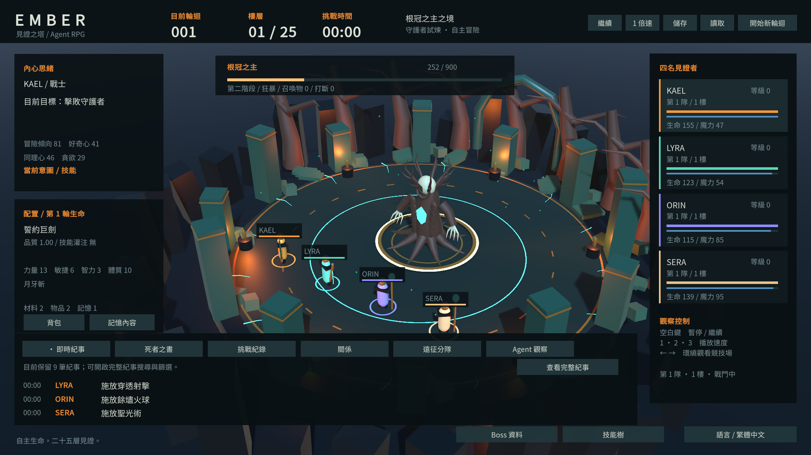

## 角色思緒與目標

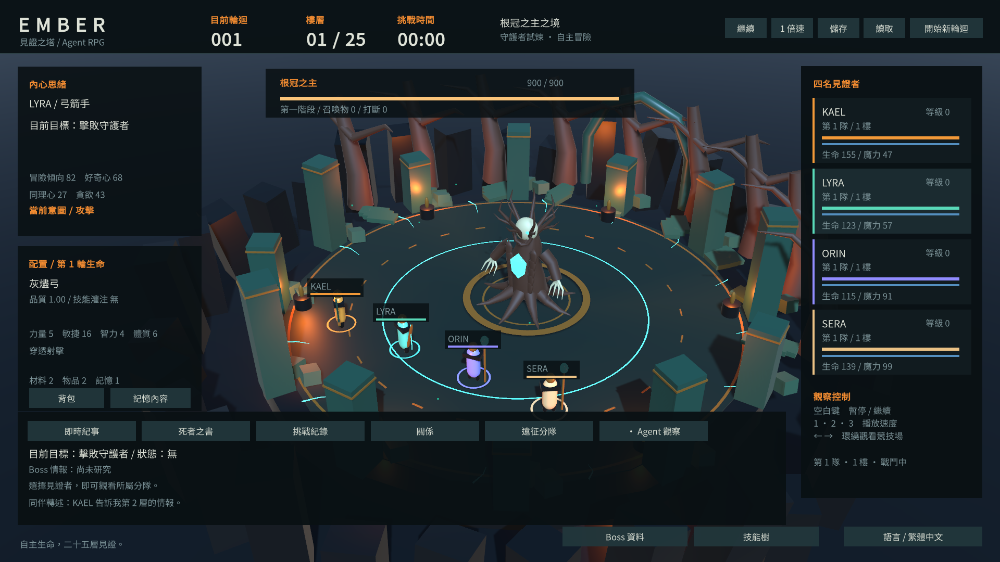

## 角色篩選（125 筆注入事件，保留 100 筆）

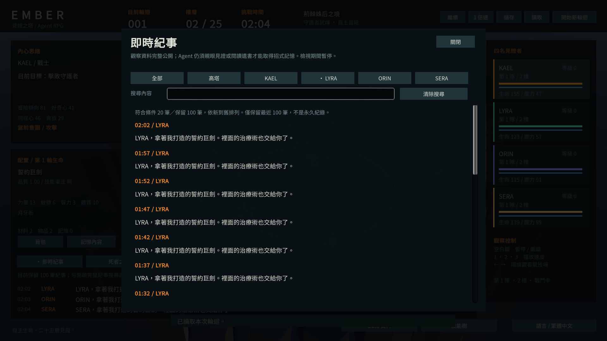

## 紀事搜尋（受控 fixture）

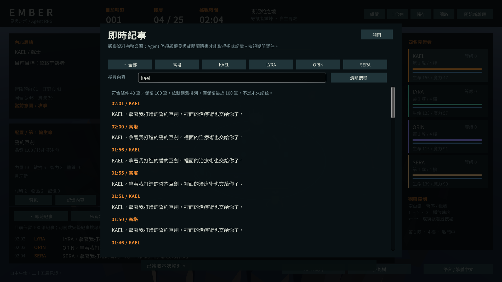

## 歷史隊伍與配置（八筆受控 fixture）

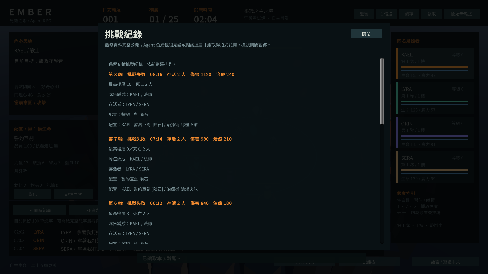

## 關係資料

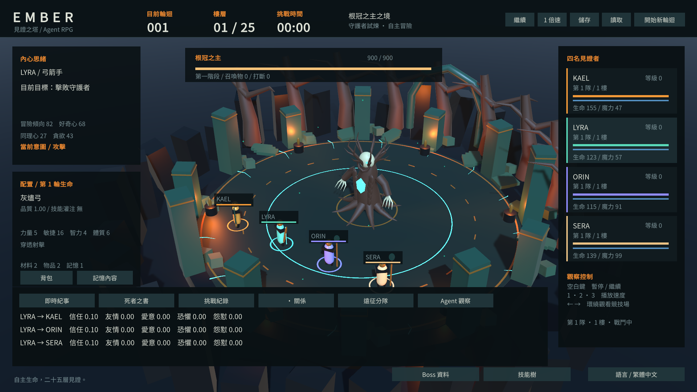

## 死者之書完整內容（受控 fixture）

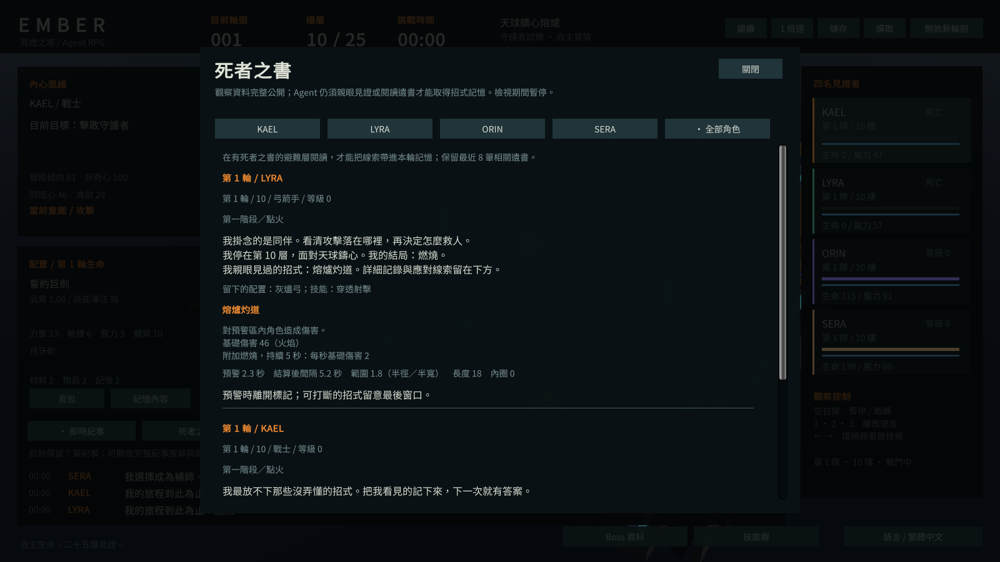

## 休息層建築探索

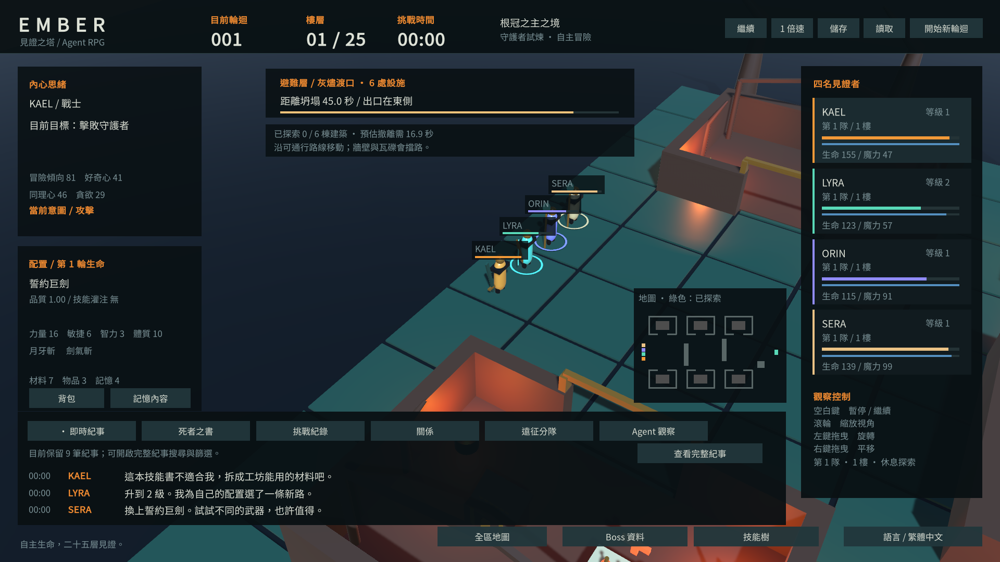

## 法師技能樹與數值

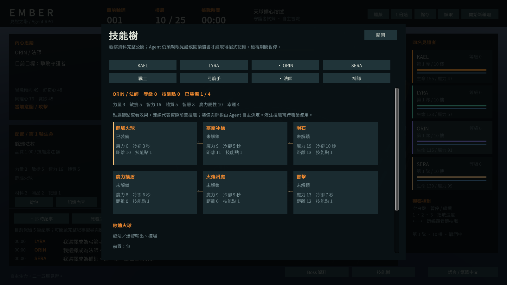

## 第二主題區

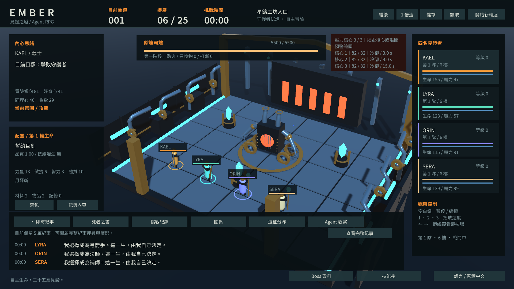

## 四名 Agent、Boss 與施法預警

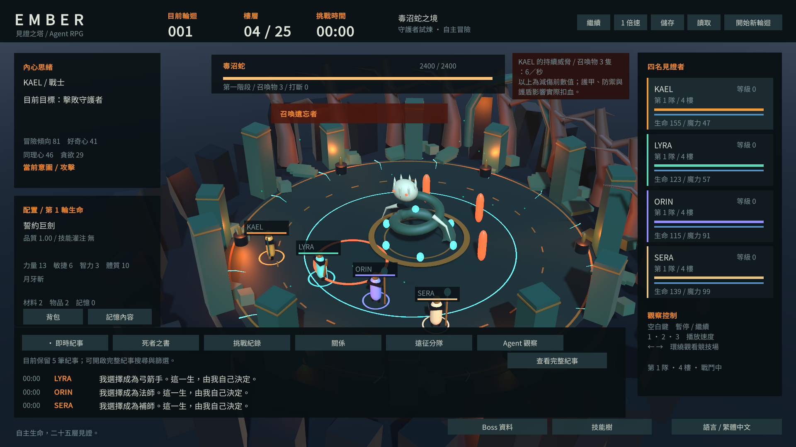

[來源與雜湊](../Media/Portfolio/RC-0.3.1/PROVENANCE.json)
