# 實機圖集

靜態遊戲圖片皆來自 Windows Player。部分圖片使用腳本設定的受控測試狀態，並非連續自然遊玩的錄影。歷史畫面均標示當時版本，不代表最新版再次通過那些歷史測試。

所有遊戲畫面均為實機截圖，未使用 AI 生成或修改遊戲內容。歷史版本、受控 fixture 與最新 Team Balance 畫面分開標示；範例狀態不代表自然遊玩通關。

## 休息層連續動態

[MP4 原片](../Media/Portfolio/refuge-demo.mp4)：2026-10-11，已修補 Windows 展示版，8 秒原速無聲、局部畫面。保留連續時間，未生成或重排遊戲內容；角色移動與倒數可直接觀察。較完整的戰鬥示範仍待補齊。[檢查紀錄](../Evidence/portfolio-demo-validation.json)。

## 四名 Agent、Boss 與可應對的持續威脅

*Team Balance 隊伍平衡版本，最終 Windows 發佈版檢查*

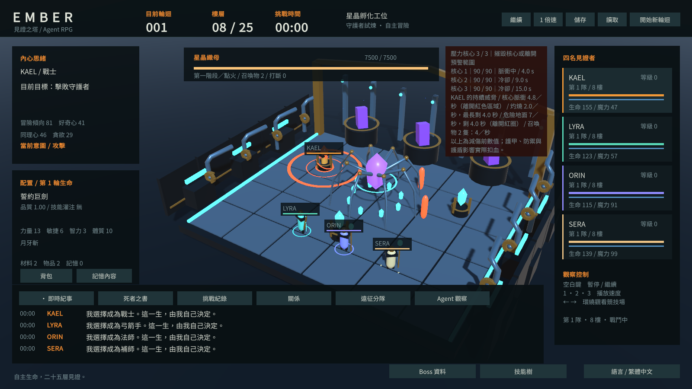

## 天球鑄心：第二主題區的守護者造型

*歷史 CombatArt 版本，戰鬥演出檢查*

## 根冠之主：造型與場景

*歷史 CombatArt 版本，戰鬥演出檢查*

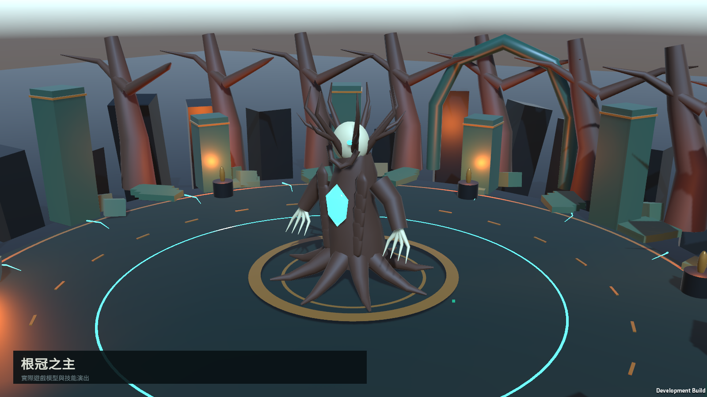

## 雷擊技能效果

*歷史 CombatArt 版本，戰鬥演出檢查*

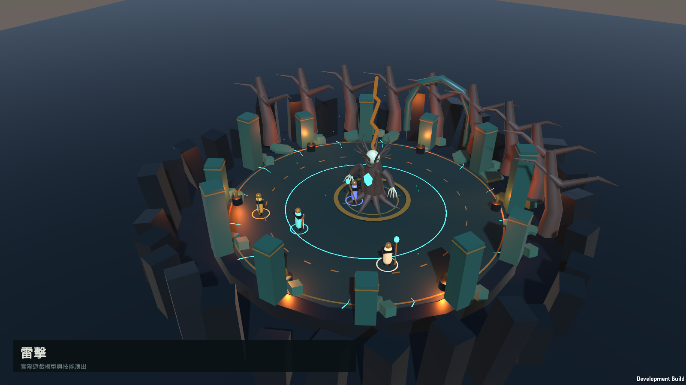

## 六棟建築的林間避難層

*歷史 RefugeExploration 版本，避難層探索檢查*

## 鑄造區內部與設施

*歷史 RefugeExploration 版本，避難層探索檢查*

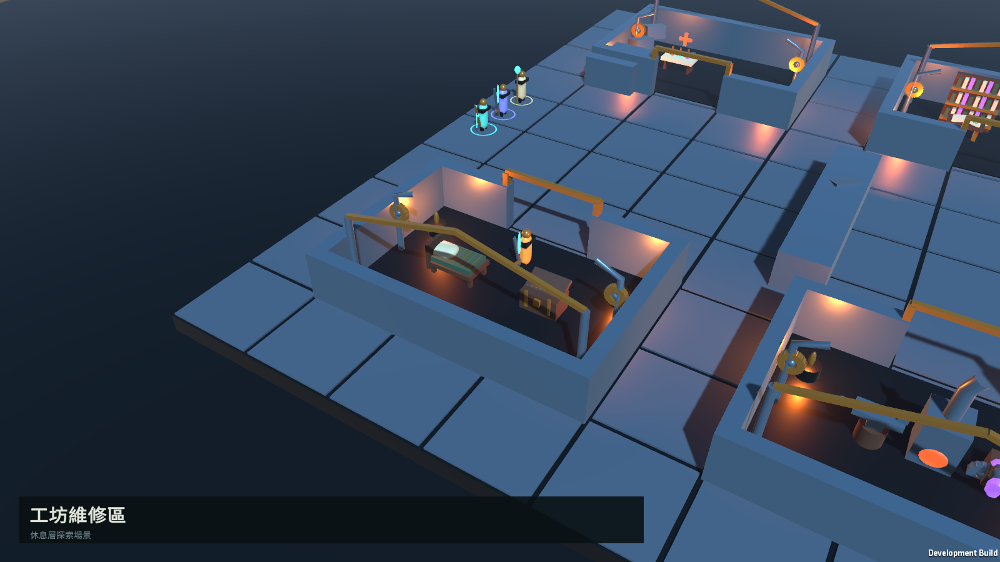

## 思緒、狀態與觀察視角

*歷史 AgentInspection 版本，角色資訊檢查*

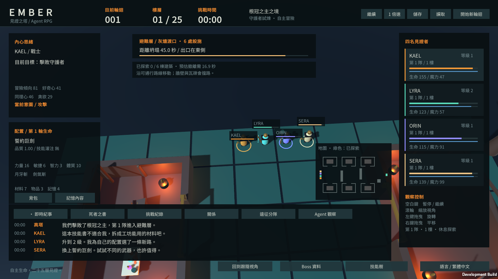

## 背包內容

*歷史 AgentInspection 版本，角色資訊檢查*

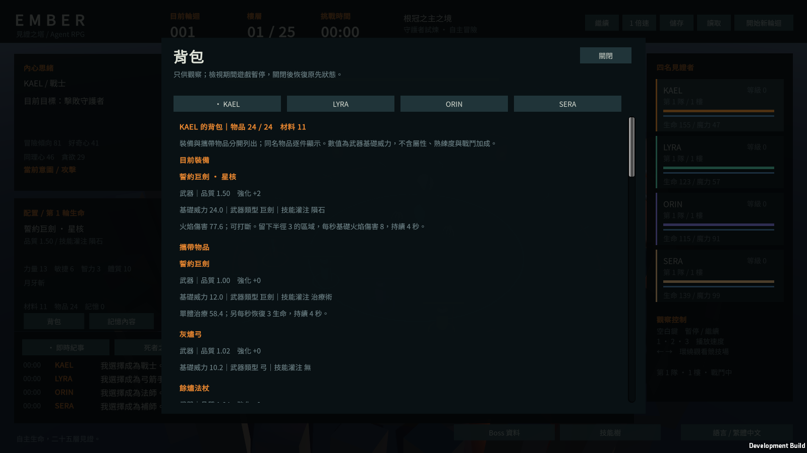

## 記憶內容與來源

*歷史 AgentInspection 版本，角色資訊檢查*

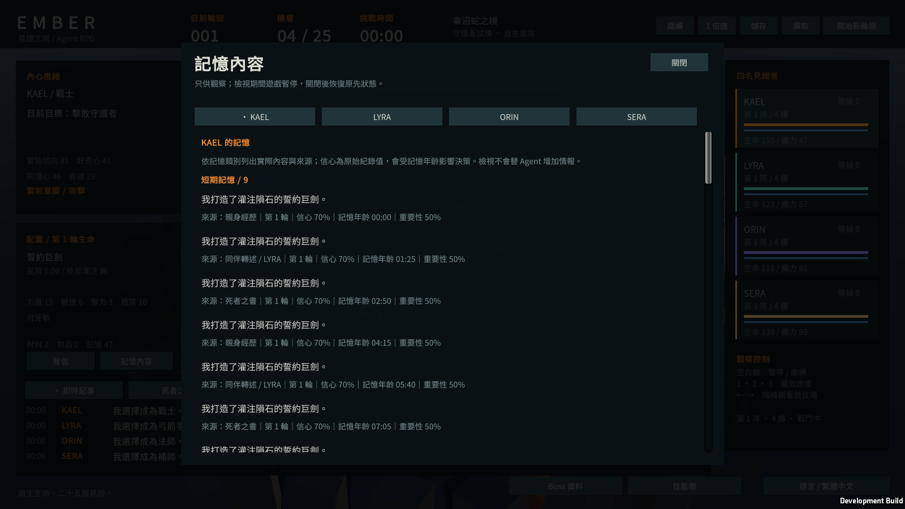

## 法師技能樹

*Team Balance 隊伍平衡版本，最終開發版檢查*

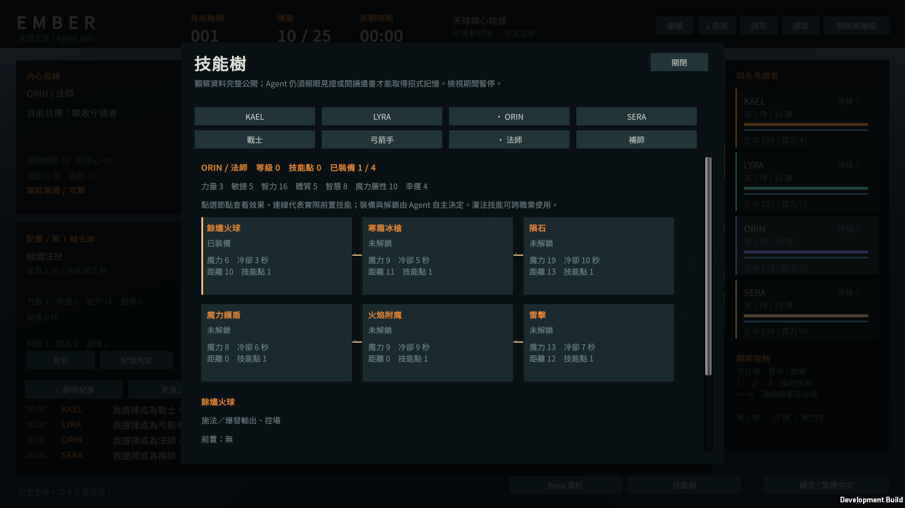

## 補師定位與技能實際數值

*Team Balance 隊伍平衡版本，最終開發版檢查*

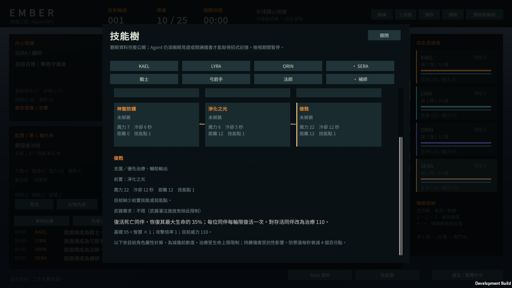

## Boss 招式與數值

*Team Balance 隊伍平衡版本，最終開發版檢查*

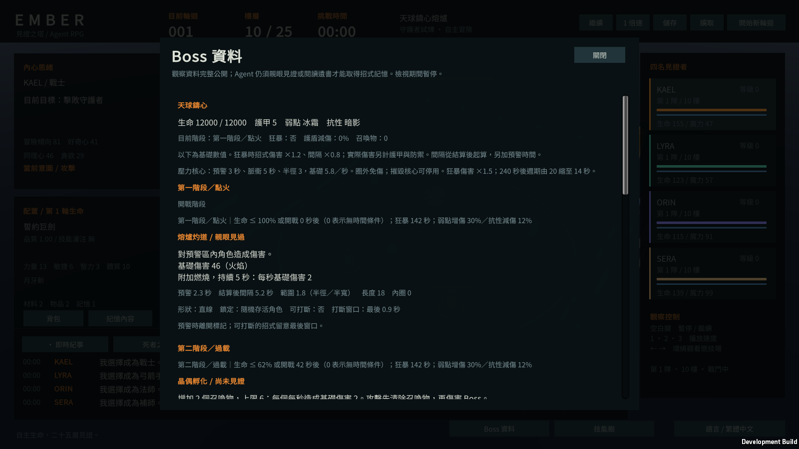

## 死者之書完整閱讀介面

*Team Balance 隊伍平衡版本，最終開發版檢查*

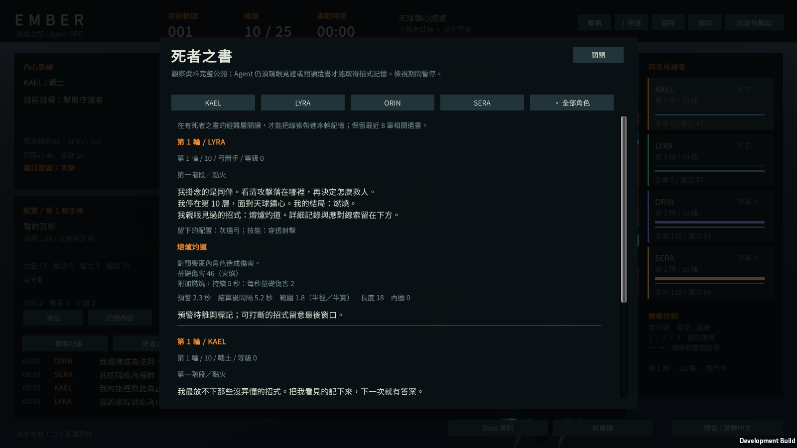

## 有向關係介面

*歷史 Phase 3.1.1 EXP2.1 版本，分隊與關係檢查*

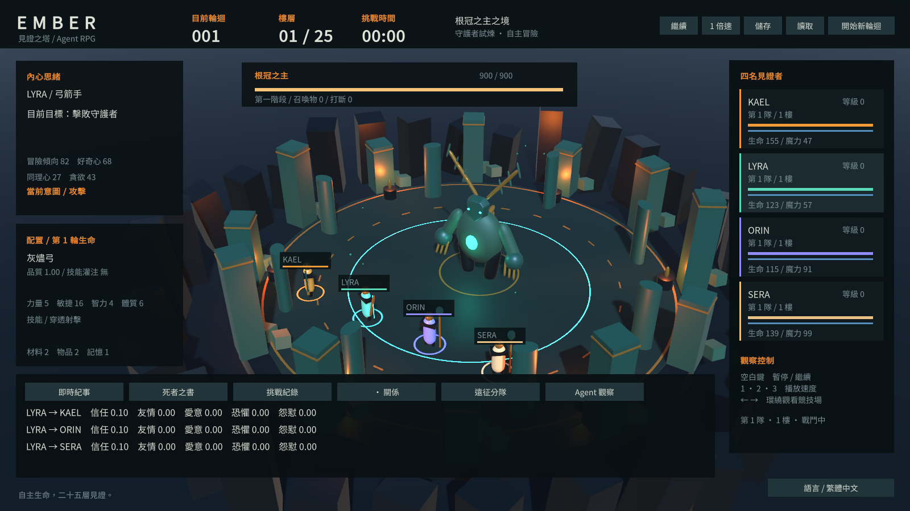

## 第二主題區的分隊與獨立樓層

*歷史 Phase 3.1.1 EXP2.1 版本，分隊與關係檢查*

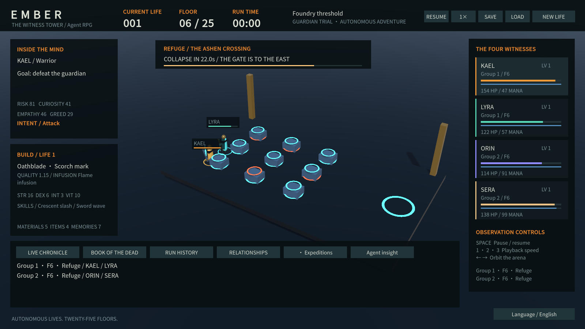

## 技術圖解

架構、行動與記憶流程圖是技術說明圖，不是遊戲截圖。平衡比較圖僅使用最新受控測試資料。

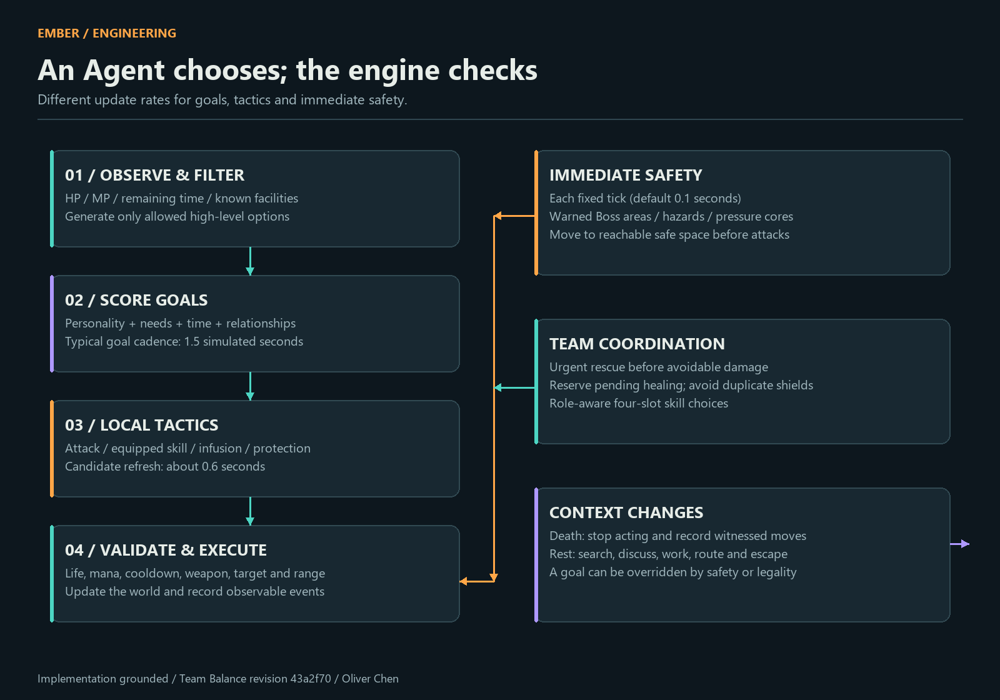

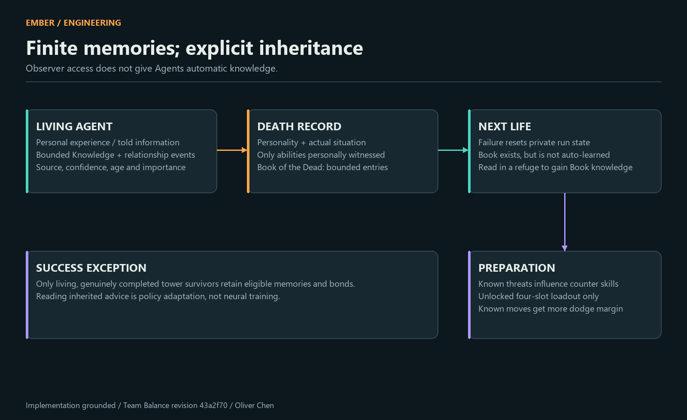

[README](../README.md) · [工程證據](ENGINEERING_EVIDENCE.md) · [審閱指南](REVIEW_GUIDE.md)
